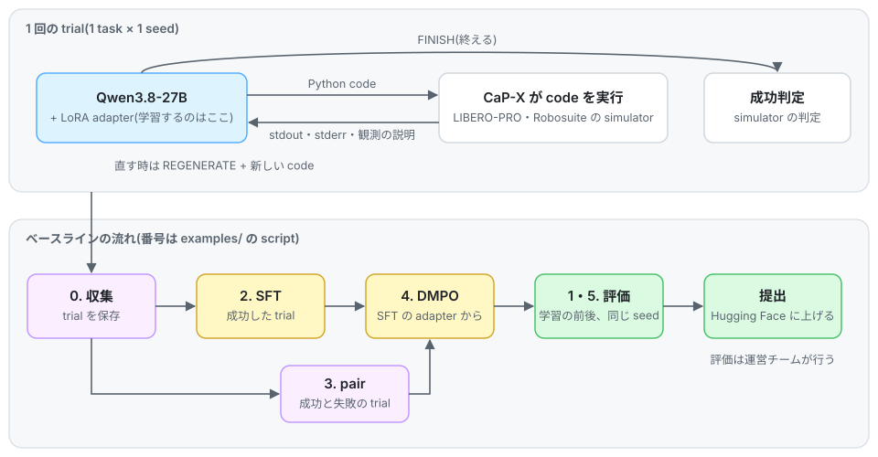

# GENIAC-PRIZE 2026 テーマ2 ベースラインコード

GENIAC CaP コンペティションのベースラインである。Qwen3.8-27B がロボットを動かす Python のコードを書き、実行結果を見て書き直すエージェント([CaP-X](https://github.com/capgym/cap-x) の multi-turn loop)を、LoRA の SFT と DMPO で学習する。
データ収集、学習、評価の script とベースラインの結果を含む。
CaP-X は再実装せずに呼び出し、依存する挙動には、コードの中に CaP-X のソースの行番号を出典として付けている。

<picture>
  <source media="(prefers-color-scheme: dark)" srcset="docs/img/pipeline-dark.svg">
  
</picture>

- 1 回の trial では、model が code を書き、CaP-X が simulator で実行して stdout・stderr と観測の説明を返す。
  model は書き直す(`REGENERATE`)か終える(`FINISH`)を選ぶ。
- 学習するのは model の LoRA adapter だけである。
  成功した trial で SFT し、同じ task の成功と失敗の trial の pair で DMPO を掛ける。
- 提出の手順(image と `submission.yaml`)は、この repo ではなく評価チームの submission repository に書かれている([Submission](#submission))。

## Tutorial

GMO クラウドの Slurm クラスタで、ログインから提出までを順に行う手順([docs/tutorial/](docs/tutorial/README.md))。全ての手順を丁寧に追うために用いる。
各コードの仕様は[Documentation](#documentation)を、詳細な手順を省いた実行方法は[Quickstart](#quickstart)を参照すること。

1. [GMO クラウドへのログイン](docs/tutorial/01_login.md)
2. [基本的な Slurm コマンドの確認](docs/tutorial/02_slurm.md)
3. [開発コードのクローン](docs/tutorial/03_clone.md)
4. [依存関係のインストール](docs/tutorial/04_install.md)
5. [テスト実行](docs/tutorial/05_test.md)
6. [W&B 連携](docs/tutorial/06_wandb.md)
7. [データ収集](docs/tutorial/07_collect.md)
8. [学習実行](docs/tutorial/08_train.md)
9. [ローカル評価の実行](docs/tutorial/09_eval.md)
10. [Hugging Face へのアップロード](docs/tutorial/10_upload.md)

## Baseline results

全 37 task の成功率である。
LIBERO-PRO 30 task は seed 441-450、491-500、541-550、591-600、641-650、Robosuite 7 task は seed 401-450 で測り、どれも学習に使っていない seed である(1 task 50 trial)。
値は ASPIRE で測ったもので、1 run ずつである。task ごとの数と測った条件は [docs/results.md](docs/results.md) にある。

| モデル | LIBERO-PRO 30 | Robosuite 7 | 合計 |
| --- | :-: | :-: | :-: |
| Qwen3.8-27B(学習前) | 490/1500(32.7%) | 122/350(34.9%) | 612/1850(33.1%) |
| SFT(34 task)+ DMPO | 894/1500(59.6%) | 185/350(52.9%) | 1079/1850(58.3%) |

## Requirements

| 段階 | GPU | 確認した環境 | 時間(B300 1 枚) |
| --- | --- | --- | --- |
| 収集 | 1 枚に Qwen3.8-27B(bf16、約 54 GB)の vLLM サーバー 1 つと Molmo2-8B。既定の割り当ては memory の 0.62 + 0.28 | NVIDIA B300(275 GB)1 枚 | - |
| 評価 | 1 枚に Qwen3.8-27B のサーバー 2 つ(VDM とコード生成、各 0.30)と Molmo2-8B(0.28)。memory の小さい GPU では run spec の `qwen_gpu_util`、`max_model_len`、`tensor_parallel_size` を変える | B300 1 枚 | LIBERO-PRO 9 task × 50 trial で 3〜4 h、Robosuite 4 task × 50 trial で 7〜14 h(実測) |
| SFT / DMPO | 1 枚、bf16 の LoRA。1 行が最長 85k token 程度 | B300 1 枚 | SFT は 3711 行 × 3 epoch で約 62 h、DMPO は train 521 pair × 3 epoch で約 80 h(どちらも推定) |
| 変換、計画、採点 | 不要(CPU) | Python 3.10、3.12 | - |

ソフトウェアの版は vLLM 0.26.0 で、学習には Python 3.12 と `requirements-train.txt` を使う。

## Installation

```bash
git clone git@github.com:matsuolab/geniac_prize_2026_baseline.git && cd geniac_prize_2026_baseline
uv venv && uv pip install -e ".[dev]"      # 収集と学習に要る extra は docs/installation.md
bash patches/geniac_prize/setup.sh         # コンペの CaP-X(geniac_prize_2026_code + patch)を作る
geniac-baseline template --model-dir <Qwen3.8-27B snapshot> --out runs/qwen38_low_reasoning.jinja
```

収集と評価では、コンペの CaP-X([geniac_prize_2026_code](https://github.com/matsuolab/geniac_prize_2026_code))を
このリポジトリの中に clone して呼ぶ。構成の図と venv の作り方は [docs/installation.md](docs/installation.md) にある。
ベースラインの数字は ASPIRE で測ったので、出し直す時だけ [docs/reproduce_baseline.md](docs/reproduce_baseline.md) を使う。

## Quickstart

事前に [Installation](#installation) を済ませ、`configs/` の `model_path` と `molmo_path` に model の snapshot を設定する。
B300 では `b300_workarounds: true` にする。

```bash
# 0. データを集める。成功の行は SFT に、失敗の行は DMPO に使う      [実行は GPU]
#    -> runs/data/split/(成功)、runs/data/fail_tagged/(失敗)
RUN_GPU=1 TOKENIZER=<model snapshot> bash examples/00_collect_data.sh
# 1. 学習前のモデルを評価する                                     [GPU]
#    -> runs/eval_base/score.json
RUN_GPU=1 bash examples/01_eval_base_cap_agent0.sh
# 2. SFT(応答部分だけの cross-entropy)                           [GPU]
#    -> runs/train_sft/epoch-N/adapter/、runs/train_sft/best_epoch.json(val の loss が最小の epoch)
RUN_GPU=1 bash examples/02_train_sft.sh
# 3. 成功と失敗の trajectory の pair を作る                        (CPU)
#    -> runs/data/pairs/
bash examples/03_build_pairs.sh
# 4. best_epoch.json の epoch の SFT adapter から DMPO を掛ける     [GPU]
#    -> runs/train_dmpo/adapter/
RUN_GPU=1 bash examples/04_train_dmpo.sh
# 5. DMPO の adapter を 1 と同じ seed で評価する                   [GPU]
#    -> runs/eval_trained/score.json
RUN_GPU=1 bash examples/05_eval_trained_cap_agent0.sh
```

`RUN_GPU=1` を付けない場合、各スクリプトは `configs/` の config を点検し、実行計画を書き出して終わる。
学習の `02_train_sft.sh` と `04_train_dmpo.sh` はこの点検でも model の tokenizer で行を encode するので、GPU が無くても `[train]` extra(torch を含む)が要る。
既定の spec は Robosuite で、LIBERO-PRO は `SPEC=configs/collect_libero.yaml`、`SPEC=configs/eval_base_libero.yaml`、`SPEC=configs/eval_trained_libero.yaml` で選ぶ。

## Documentation

| ページ | 内容 |
| --- | --- |
| [tutorial/](docs/tutorial/README.md) | GMO クラウドでのチュートリアル(1 手順 1 ページ) |
| [installation.md](docs/installation.md) | インストール: 構成、このパッケージ、コンペの CaP-X、モデルの重み |
| [glossary.md](docs/glossary.md) | 用語とタスクの一覧 |
| [data_format.md](docs/data_format.md) | データ形式、train / val の分割と pair |
| [collect.md](docs/collect.md) | データ収集 |
| [train.md](docs/train.md) | 学習: SFT、epoch の選び方、DMPO |
| [eval.md](docs/eval.md) | 評価、採点、refill |
| [results.md](docs/results.md) | タスクごとのベースラインの結果 |
| [setup.md](docs/setup.md) | setup script と patch(`patches/`): コンペの CaP-X と ASPIRE の変更点 |
| [reproduce_baseline.md](docs/reproduce_baseline.md) | ASPIRE でベースラインの数字を出し直す |
| [remote_qwen.md](docs/remote_qwen.md) | BEHAVIOR-1K のタスクを ASPIRE で RTX のクライアントで動かし、Qwen は B300 から SSH トンネルで配信する |

## Submission

提出の手順(image と `submission.yaml`)は [評価コード用のリポジトリ](https://github.com/matsuolab/geniac_prize_2026_code)の最新版を確認すること。

## License

GENIAC CaP コンペティションの参加者と運営者が、コンペティションのためにだけ使える([LICENSE](LICENSE))。
同梱する第三者のコードとデータは、それぞれのライセンスに従う([THIRD_PARTY_NOTICES.md](THIRD_PARTY_NOTICES.md))。

## Credits

このリポジトリは、GENIAC(Generative AI Accelerator Challenge)プロジェクトの一環として、GENIAC-PRIZE 2026 の
ために開発された。

- [CaP-X](https://github.com/capgym/cap-x)(MIT)
- [ASPIRE](https://github.com/NVlabs/ASPIRE)(Apache 2.0)
- DMPO: Shi et al., Direct Multi-Turn Preference Optimization for Language Agents, EMNLP 2024(arXiv 2406.14868)。
