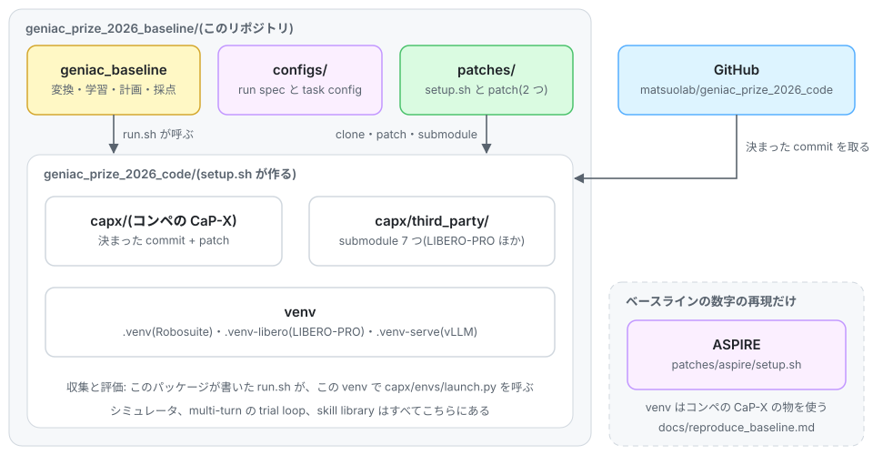

# Installation

## Overview

<picture>
  <source media="(prefers-color-scheme: dark)" srcset="img/setup-dark.svg">
  
</picture>

用意する物は 2 つある。

- **このリポジトリ(geniac_prize_2026_baseline)**: データの変換、学習、収集と評価の計画、採点を行う Python パッケージ。
  CaP-X は含まず、収集と評価では CaP-X のエントリポイント(`capx/envs/launch.py`)を呼ぶ。
- **コンペの CaP-X**: シミュレータ、multi-turn の trial loop、skill library を持つ実行環境。
  [matsuolab/geniac_prize_2026_code](https://github.com/matsuolab/geniac_prize_2026_code) の決まった commit
  を `geniac_prize_2026_baseline/geniac_prize_2026_code/` に clone し、このリポジトリの patch(修正と LIBERO 用の skill)を当てて使う
  ([setup.md](setup.md))。`bash patches/geniac_prize/setup.sh` がこれを 1 回で行う。

[results.md](results.md) のベースラインの数字は別の環境(ASPIRE)で測った。数字を出し直す時だけ
[reproduce_baseline.md](reproduce_baseline.md) を見る。それ以外ではこのページの環境だけを使う。

## This package

Python 3.10 から 3.12 で動く(テストは 3.10 と 3.12 で行った)。
clone は SSH で行うので、GitHub に SSH 鍵を登録しておく(手順は [tutorial の 3 章](tutorial/03_clone.md)の 1)。

```bash
git clone git@github.com:matsuolab/geniac_prize_2026_baseline.git && cd geniac_prize_2026_baseline
uv venv && uv pip install -e ".[dev]"        # core: data conversion, run planning, scoring (PyYAML only)
uv pip install -e ".[tag]"                   # collection host: `convert tag` needs a tokenizer
uv pip install -e ".[train]" -r requirements-train.txt \
  --extra-index-url https://download.pytorch.org/whl/cu130   # training host: the exact baseline versions
```

`examples/` は `geniac-baseline` が PATH に無い場合に `.venv/bin/geniac-baseline` を使う。任意の extra として `[wandb]` と
`[hub]`(`data: hf://...` 用)がある。

## CaP-X

```bash
bash patches/geniac_prize/setup.sh      # ./geniac_prize_2026_code: clone、決まった commit の checkout、patch、submodule
```

続けて `geniac_prize_2026_code/` の中に venv を 3 つ作る。コマンドは [tutorial の 4 章](tutorial/04_install.md)の
手順 4 と 5 にある(Slurm 以外の環境でも同じコマンドで作れる)。

| venv(`geniac_prize_2026_code/` から) | Python | 中身 | 使う所 |
| --- | --- | --- | --- |
| `.venv` | 3.10 | CaP-X、Robosuite 1.5.1 | Robosuite の収集と評価 |
| `.venv-libero` | 3.12 | CaP-X、LIBERO-PRO、Robosuite 1.4.0 | LIBERO-PRO の収集と評価 |
| `.venv-serve` | 3.12 | vLLM 0.26.0 | Qwen3.8-27B と Molmo2-8B のサーバー |

`configs/*.yaml` の既定(`capx_root: ../geniac_prize_2026_code`、`launch_script: capx/envs/launch.py`、
`sim_python`、`serve_python`)はこの配置に合わせてあり、タスクの config は `configs/capx/geniac_prize/` を使う。
patch を当てていない tree では収集と評価の点検が止まる(VDM テキストを保存しない、LIBERO の追加 skill が無いため)。

## Model weights

| model | revision | use |
| --- | --- | --- |
| Qwen/Qwen3.8-27B | `1d4bf0f2ff6012fd82039f2fa52739d0dd7c60c0` | コード生成、VDM、学習の base |
| allenai/Molmo2-8B | | nut_assembly の API が使う pointing |

local の snapshot を run spec の `model_path` と `molmo_path`、学習 config の `model` に指定する。

ベースラインの Qwen サーバーは、モデル自身の chat template の reasoning effort の既定を `low` にした template で動いた。
次のコマンドで snapshot から作り、ベースラインで使った物と同じかを sha256 で確認する。

```bash
geniac-baseline template --model-dir <Qwen3.8-27B snapshot> --out runs/qwen38_low_reasoning.jinja
```

## B300

収集と評価を B300 で動かすときは、次の 2 点が要る。

- **NVRTC**: `.venv` と `.venv-libero` には `nvidia-cuda-nvrtc-cu12` 12.8.93 が入り、これは compute 10.3 向けに JIT
  compile できない。SAM3 の server が `segment` に 500 を返し、log に
  `nvrtc: error: invalid value for --gpu-architecture` が出る。trial は別の方法で進むので rc は 0 のままになり、
  気づきにくい。compute 10.3 を扱えるのは CUDA 12.9 以降の NVRTC なので、両方の venv で
  `nvidia-cuda-nvrtc-cu12==12.9.86` を入れ直す(torch はそのまま)。
- **cuRobo**: build に CUDA toolkit(nvcc)が要り、`CUDA_HOME` にその場所を設定する。toolkit の CUDA の major は、
  その venv の torch(cu130 なら CUDA 13)と揃える。
