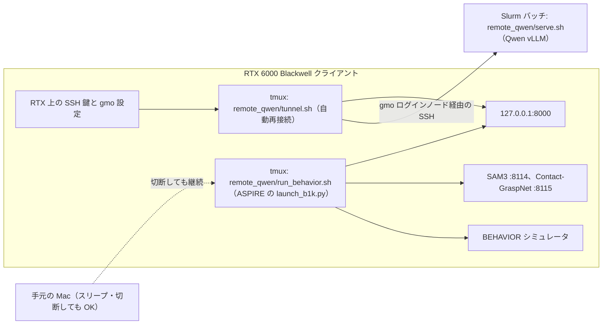

# ASPIRE 向け Qwen ホストと RTX クライアントの実行手順
ASPIRE の Behavior タスクは、Isaac Sim を必要とするが、Isaac Sim は B300 では動かない。それでも Qwen は B300 で動かして、それにリクエストを送ることで、重めの Qwen を効率的に動かすことができる。ここではその手順を説明する。

ASPIRE（この repo の ASPIRE tree、`f4c8939` + `patches/aspire/` の patch）で BEHAVIOR-1K のタスクを動かすとき、重たい Qwen（`Qwen/Qwen3.8-27B`）の推論サーバーだけを B300（Qwen ホスト）上で動かし、SSH トンネル経由で RTX クライアント（`http://127.0.0.1:8000/v1`）へ接続します。
- **RTX クライアント側**: ASPIRE 本体、BEHAVIOR シミュレータ（OmniGibson 3.9 / Isaac Sim 5.1）、SAM3 と Contact-GraspNet（ASPIRE の launch が起動します）、Molmo（任意）
- **Qwen ホスト（B300）側**: Qwen の vLLM サーバーのみ

スクリプトはすべて `remote_qwen/` にあります。



---

## 1. Qwen ホスト（B300）での vLLM 起動

vLLM サーバー用の Slurm ジョブには、十分な **ホスト RAM（CPU メモリ）** が必要です。最低でも 64GiB を割り当てるようにしてください（`serve.sh` はそれより少ないと止まります）。

vLLM は [installation.md](installation.md) の `.venv-serve`（`geniac_prize_2026_code/.venv-serve`）を使います。別の環境を使う場合は `SERVE_PY=<vLLM の python>` を指定します。

### バッチジョブとして投入する（推奨）

B300 クラスタのログインノードから以下を実行します（引数はそのまま `sbatch` に渡り、既定値を上書きします）：

```bash
cd /path/to/geniac_prize_2026_baseline
bash remote_qwen/submit.sh --partition=<パーティション>
```

このスクリプトは、Qwen のサーバーを立てます。デフォルトでは 24 時間です（`--time=...` で変更できます。初回起動時はモデルのダウンロードが行われるので、必要なら `HF_HOME` を設定してから投入します）。

実行すると表示される `JOB_ID` を使って、割り当てられた計算ノード名とログを確認します：

```bash
squeue -h -j JOB_ID -o '%i %T %N %l'
tail -f runs/qwen_server/qwen-server-JOB_ID.out
```

- 割り当てられる計算ノード名は毎回変わる可能性があるため、後述の SSH トンネルには必ず `squeue` で表示されたノード名を指定してください。
- サーバーが不要になったら `scancel JOB_ID` で停止します。

<details>
<summary><b>補足：インタラクティブジョブで起動する場合（クリックで展開）</b></summary>

インタラクティブな Slurm ジョブを作る場合は、必ず `--mem=64G` 以上を指定してください。割り当てられた計算ノード上で以下を実行します（長時間動かす場合は `tmux` 内で実行してください）：

```bash
cd /path/to/geniac_prize_2026_baseline
bash remote_qwen/serve.sh
```

</details>

### 起動確認

ログに vLLM が listen 状態になったことが表示されたら、計算ノード上で以下を実行し、レスポンスに `Qwen/Qwen3.8-27B` と `"max_model_len": 122880` が含まれていることを確認します：

```bash
curl -fsS http://127.0.0.1:8000/v1/models | python -m json.tool
```

---

## 2. RTX クライアントへの SSH トンネル接続

### ① SSH 鍵の作成と `~/.ssh/config` の設定（初回のみ）

まだ設定していない場合は、**RTX クライアント上で** GMO 接続用の SSH 鍵を作成します：

```bash
umask 077
mkdir -p "$HOME/.ssh"
ssh-keygen -t ed25519 -f "$HOME/.ssh/aspire_gmo_ed25519" \
  -C "$(id -un)@$(hostname)-aspire"
cat "$HOME/.ssh/aspire_gmo_ed25519.pub"
```

- 出力された **公開鍵（`.pub`）の内容のみ** を GMO アカウントに登録してください（秘密鍵は他のマシンへコピーしないでください）。
- この SSH 鍵には、パスフレーズなしのものを使ってください。トンネルは SSH agent を使わず、この鍵ファイルで再接続するため、パスフレーズ付きの鍵だと切断時に自動再接続できません。

続いて、**RTX 上の** `$HOME/.ssh/config` に以下を追加します（`GMO_ACCOUNT` は自分の GMO ユーザー名に置換）：

```sshconfig
Host gmo
    HostName connect.gpucloud.gmo
    Port 8822
    User GMO_ACCOUNT
    IdentityFile ~/.ssh/aspire_gmo_ed25519
    IdentitiesOnly yes
```

パーミッションを設定し、ログインノードと Qwen が動いている計算ノード（`QWEN_COMPUTE_NODE`）の両方にパスワード入力なしで接続できることを確認します：

```bash
chmod 700 "$HOME/.ssh"
chmod 600 "$HOME/.ssh/config" "$HOME/.ssh/aspire_gmo_ed25519"
ssh gmo hostname
ssh -J gmo GMO_ACCOUNT@QWEN_COMPUTE_NODE hostname
```

### ② SSH トンネルの起動

**RTX クライアント上で** 以下のコマンドを実行し、`tmux` セッション `qwen_tunnel` で常駐する SSH トンネルを起動します（接続先の計算ノードを変更する場合は、先に既存のセッションを kill します）：

```bash
cd /path/to/geniac_prize_2026_baseline
tmux kill-session -t qwen_tunnel  # セッションが存在する場合のみ
bash remote_qwen/tunnel.sh GMO_ACCOUNT@QWEN_COMPUTE_NODE
```

- トンネルは RTX 上で自動再接続されるため、作業用の Mac をスリープ・切断しても維持されます。様子は `tmux attach -t qwen_tunnel` で確認できます。
- Qwen の Slurm ジョブを出し直して計算ノード名が変わった場合は、新しいノード名でトンネルを再起動してください。
- RTX の 8000 番ポートを別のトンネル（`aspire_qwen_tunnel` など）が使っていると接続に失敗し続けます。先にそちらを止めてください。

### ③ トンネル経由の疎通確認

RTX クライアント上で Qwen サーバーから応答が返るか確認します：

```bash
curl -fsS http://127.0.0.1:8000/v1/models | python -m json.tool
curl -fsS http://127.0.0.1:8000/v1/chat/completions \
  -H 'Content-Type: application/json' \
  -d '{"model":"Qwen/Qwen3.8-27B","messages":[{"role":"user","content":"Reply with READY."}],"max_tokens":128,"chat_template_kwargs":{"enable_thinking":false}}' \
  | python -m json.tool
```

---

## 3. RTX クライアントでの ASPIRE の実行

### ① 準備（初回のみ）

- **ASPIRE tree**: `bash patches/aspire/setup.sh` で `./ASPIRE` を作ります（[reproduce_baseline.md](reproduce_baseline.md)）。別の場所なら `ASPIRE_ROOT` で指定します。
- **シミュレータの Python**（`SIM_PY`）: OmniGibson 3.9 と Isaac Sim 5.1、SAM3、Contact-GraspNet が入った環境です。コンペの CaP-X の BEHAVIOR 環境なら `capx/third_party/b1k/.venv-isaac5/bin/python` です。RTX PRO 6000（sm_120）では、OmniGibson の cuRobo が R1Pro の `DEFAULT` embodiment を外すので、それを扱う修正の入った OmniGibson が必要です（入っていないと腕の計画がすべて `KeyError: DEFAULT` で失敗します）。
- **データセット**（`OMNIGIBSON_DATA_PATH`）: `2026-challenge-task-instances` を含む BEHAVIOR のデータセットの root です。ASPIRE の patch は OmniGibson 3.9 では 2026 年版の task instance を読みます。

### ② 実行

タスクは 2 つあり、設定は `configs/capx/aspire/behavior/` にあります（ASPIRE `f4c8939` の `r1pro_pick_up_*_aspire_traced.yaml` と同じです。trash だけ SAM3 と Contact-GraspNet のポートを、R1Pro の API が接続する 8114 / 8115 に直しています）。

| task | 内容 |
| --- | --- |
| `pick_up_trash` | 床の青いソーダ缶を拾う（BEHAVIOR `picking_up_trash`） |
| `pick_up_radio` | テーブルの赤いラジオを拾う |

seed は BEHAVIOR の task instance の番号です。ASPIRE のプロトコルでは 26-35 が開発用、1-25 が評価用です。SSH が切れても止まらないよう、`tmux` 内で実行します（tmux がすでに動いていると、手元のシェルで `export` した変数は新しいセッションに渡らないので、コマンドの中で指定します）：

```bash
cd /path/to/geniac_prize_2026_baseline
tmux new -s behavior "SIM_PY=$HOME/geniac_prize_2026_code/capx/third_party/b1k/.venv-isaac5/bin/python \
  OMNIGIBSON_DATA_PATH=/path/to/behavior-data \
  bash remote_qwen/run_behavior.sh pick_up_trash 26-35; exec bash"
```

- 実行前に Qwen が `127.0.0.1:8000` で応答するかを確かめ、応答がなければ止まります（別の URL は `QWEN_URL`）。
- コード生成と画像の差分（VDM）の両方に、トンネル先の同じ Qwen を使います。
- 結果は `runs/behavior/<task>-<時刻>/outputs/Qwen_Qwen3.8-27B/<task>/trial_*` に保存されます（3 つ目の引数で出力先を指定できます）。

### ③ 採点

trial のフォルダ名（`taskcompleted_1` かつ `sandboxrc_0`）から成功率を数えます：

```bash
geniac-baseline eval score runs/behavior/<task>-<時刻>
```

<details>
<summary><b>補足：Molmo を使う場合（クリックで展開）</b></summary>

R1Pro の API の `point_prompt_molmo` は Molmo2-8B（既定 `http://127.0.0.1:8122/v1`、`CAPX_MOLMO_URL` で変更可）を呼びます。Molmo が動いていない場合、`run_behavior.sh` は警告を出して続行し、生成されたコードがこの関数を呼ぶとエラーになります。RTX 上で Isaac Sim と GPU を共有して動かす場合の設定例です：

```bash
<vLLM の python> -m vllm.entrypoints.openai.api_server --model allenai/Molmo2-8B \
  --served-model-name allenai/Molmo2-8B --trust-remote-code --host 127.0.0.1 --port 8122 \
  --dtype bfloat16 --max-model-len 4096 --max-num-batched-tokens 4096 --max-num-seqs 1 \
  --limit-mm-per-prompt '{"image": 2, "video": 0}' --gpu-memory-utilization 0.05 \
  --cpu-offload-gb 16 --enforce-eager
```

</details>
